# Recruitment ATS: a PostgreSQL database project

A small applicant tracking system built to practise database design in SQL.
The focus is the schema and the rules the database enforces on its own, with a simple Streamlit interface on top.

**Live demo:** https://ahmadabuz-recruitment-ats-appapp-ni54gf.streamlit.app/
The free app goes to sleep when idle, so the first visit may need a click on "wake up". All data is synthetic.

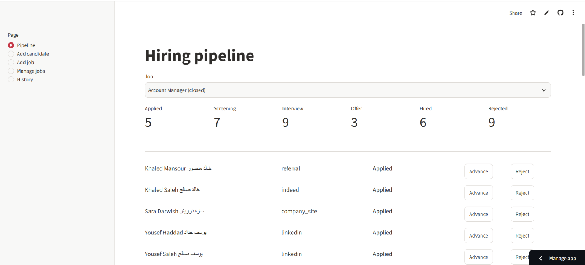
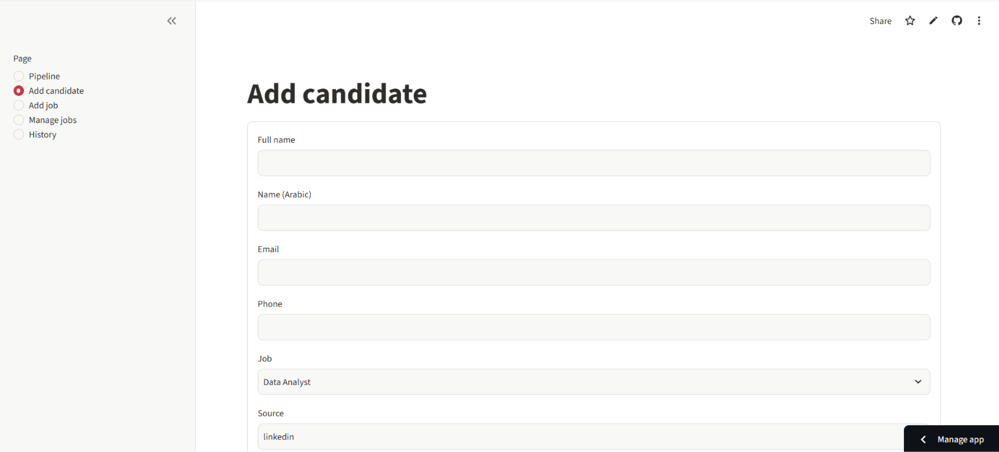
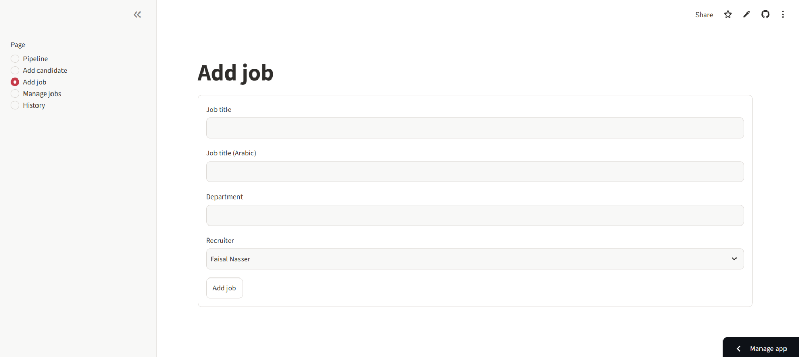
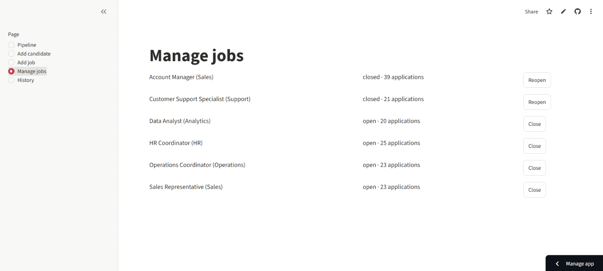
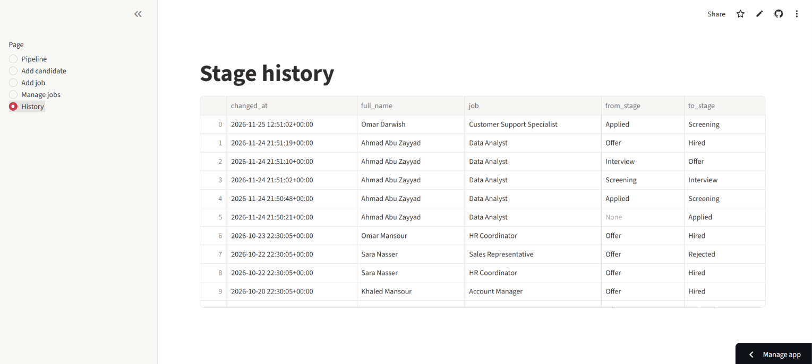

## What it demonstrates
- Relational schema design with primary keys, foreign keys and constraints
- Duplicate prevention for candidates (case-insensitive email) and for open jobs
- A trigger that logs every stage change into an audit table and blocks invalid moves
- A job lifecycle: jobs are closed instead of deleted, and closed jobs cannot receive applications
- Arabic and English names stored side by side (UTF-8)
- An index demo with `EXPLAIN ANALYZE` and a transaction rollback test
- Three example SQL queries (joins, aggregates, window functions)
- A Python data generator and a Streamlit interface

## Schema
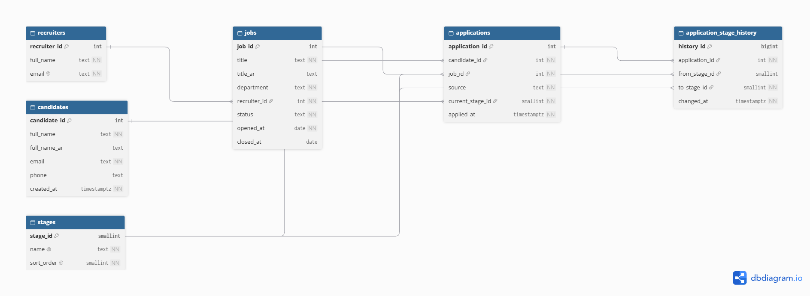

Design decisions:
- **`stages` is a lookup table**, not free text, so typos can't happen and `sort_order` lets the trigger check the order of moves.
- **`current_stage_id` plus a history table.** The current stage is quick to read, and the history keeps every change.
- **`UNIQUE (candidate_id, job_id)`** stops a candidate from applying to the same job twice.
- **Jobs are closed, not deleted**, so applications and history stay available for reporting.

## Rules enforced by the database
| Rule | How |
|---|---|
| No duplicate candidate emails (case-insensitive) | unique index on `lower(email)` |
| Valid email format | `CHECK` constraint |
| Every stage change is logged automatically | `AFTER INSERT OR UPDATE` trigger |
| Only one step forward, or reject from any open stage | same trigger raises an error otherwise |
| Hired and Rejected are final | same trigger raises an error otherwise |
| One open job per title (case-insensitive) | partial unique index `WHERE status = 'open'` |
| A closed job must have a closing date | `CHECK` constraint |
| No applications to closed jobs | trigger on `applications` |
| Department is required for every job | `NOT NULL` |

Closed jobs don't count toward the duplicate rule, so a role can be posted again after it is filled, and each posting keeps its own applications and history.


## Index demo
To see what an index does, I filtered a separate test table with 300,000 rows.
- Without an index, the database checked every row: **15.3 ms**
- With an index, it jumped straight to the matching rows: **0.059 ms**, about 260x faster

The same idea applies to the history table, where an index helps look up the changes of one application quickly.

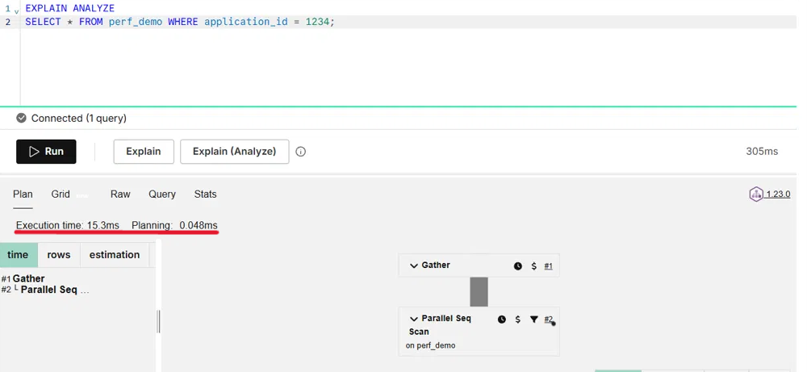 
<br>
<br>
<br>
<br>
<br>
<br>
<br>

 

## Transactions
A valid stage move followed by an invalid one inside one transaction caused the whole transaction to roll back, leaving the application unchanged. In PostgreSQL an error aborts the transaction, so the final `COMMIT` acts as a rollback.

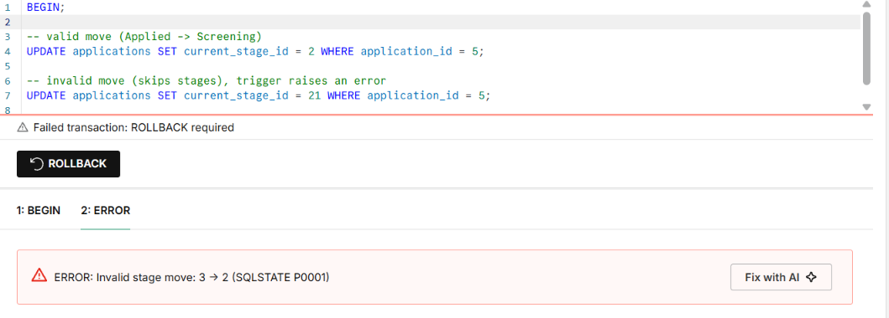

## Example queries
`sql/04_queries.sql` has three queries: funnel by stage, average days in each stage, and hire rate by source. The data is synthetic and randomly generated, so the results only show that the queries work, not real hiring patterns.

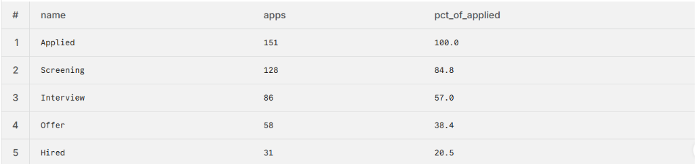
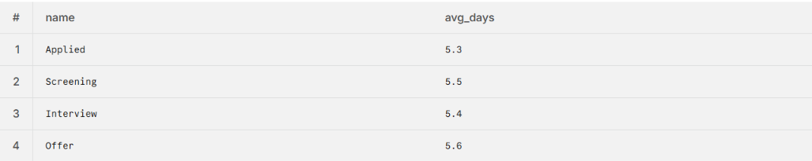
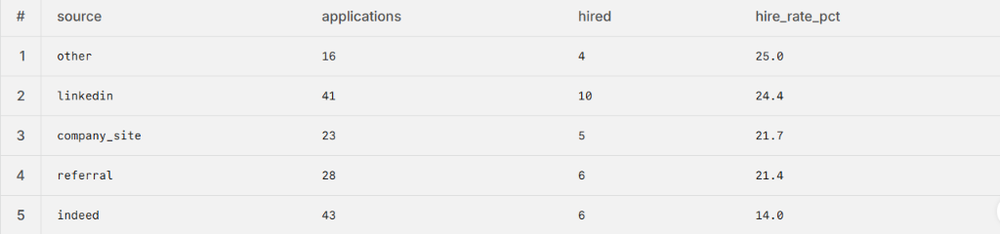

## Project structure
```
sql/       01_schema, 02_triggers, 03_seed_minimal, 04_queries, 05_job_lifecycle
app/       Streamlit app
scripts/   synthetic data generator
docs/      ER diagram and screenshots
```

## Run it locally
1. Create a free Postgres database (for example on Neon).
2. Run the SQL files in order: `01_schema.sql`, `02_triggers.sql`, `03_seed_minimal.sql`, then `05_job_lifecycle.sql`. In the Neon SQL Editor, run each statement separately.
3. Copy `.env.example` to `.env` and set `DATABASE_URL`.
4. `pip install -r requirements.txt`
5. `python scripts/generate_data.py` (optional, adds sample data; run it once)
6. `streamlit run app/app.py`

## Tech
PostgreSQL (Neon), Python, Streamlit, psycopg2, pandas
